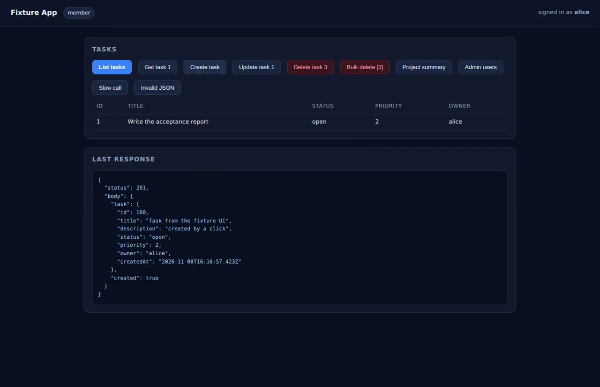
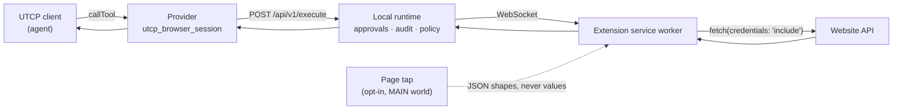
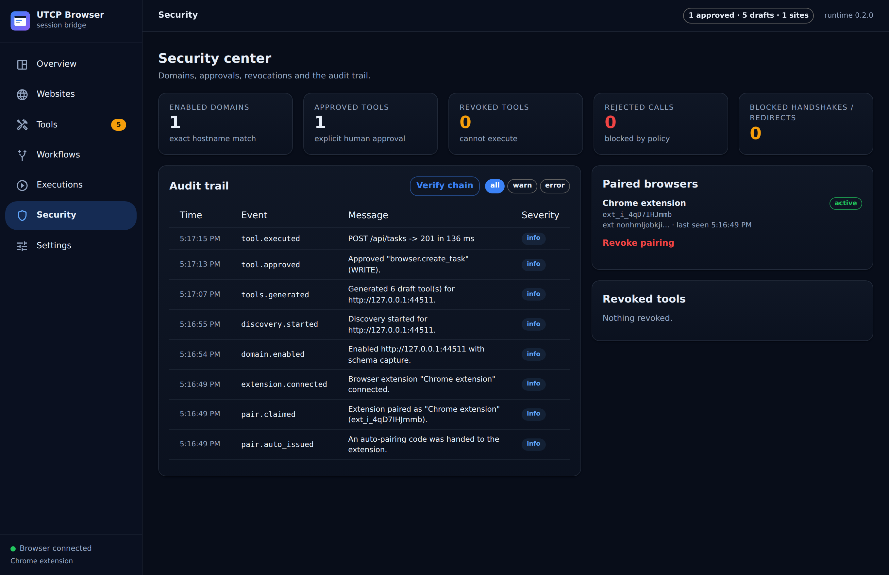

<div align="center">


**Your browser is already logged in. Let your agent use it — without ever touching a cookie.**

[](LICENSE)
[](#compatibility)
[](https://github.com/universal-tool-calling-protocol/typescript-utcp)
[](#development)
[](#quick-start)

[Quick start](#quick-start) · [How it works](#how-it-works) · [Security](#security) · [Compatibility](#compatibility) · [Docs](#documentation) · [Roadmap](#roadmap)

</div>

---

UTCP Browser Session turns the websites you are already signed in to into
**UTCP tools an AI agent can call**. A Chrome extension observes the API behind
a page you use, you review what it found, and the agent calls it later — with the
browser attaching your existing session at the network layer.

No cookie export. No per-site server. No OAuth app per integration. No stealth.

```text
UTCP client  →  utcp_browser_session  →  local runtime  →  Chrome extension  →  website
                 (real @utcp/sdk)        (approvals,        (your session,
                                          audit)             never readable)
```

## Demo

Recorded from a real run — the fixture site, the runtime and the unpacked
extension, no mockups. The popup is already paired when it opens: nobody types a
code.

<div align="center">

https://github.com/hungpt99-dev/utcp-browser-session/blob/main/docs/screenshots/demo.mp4



</div>

| | |
| --- | --- |
|  |  |
| **Popup after `up`**: connected, paired, one origin capturing — no pairing form | **Overview** after a real run: 10 discovered APIs, 1 approved, 1 execution |
|  |  |
| **Discovery**: what the extension actually saw, with permission classification | **Review**: a draft write tool with its inferred input schema |
|  |  |
| **Execution** from the inspector — the JSON is the real 201 response | **Inspector**: sanitized metadata, redacted preview, no headers |

## The problem

An agent that needs your Jira, Linear, Notion or internal admin panel usually
means one of: a dedicated MCP server per service, a personal access token, or an
OAuth app you have to register and consent to. That is a lot of integration work
for capabilities you *already have open in a tab*.

Existing browser-automation projects solve a different problem: they launch their
own browser and drive a page. That browser is not logged in, and every action
pays DOM-interaction cost.

This project takes the third path: reuse the session, call the API, and leave the
credential where it already lives.

## How it works



1. **Pair once — without typing.** `up` writes a one-time pairing record bound
   to the extension id it launched; the extension claims it over loopback, then
   the normal key exchange happens: ECDSA P-256, per-socket nonce, 60 s skew,
   single use. The runtime stores only the public half. Auto-pairing removes the
   *typing*, never the exchange.
2. **Enable a site.** Exact hostname plus a pinned origin. Nothing else on the
   internet becomes reachable.
3. **Discover.** With capture on, the extension records method, path, query names,
   status and content type via `webRequest`. If you enable schema capture, a
   page-level tap also reports the *structure* of JSON requests and responses
   (types only, never values).
4. **Review.** Discovery produces **draft** tools. A human approves them, renames
   them, or throws them away. Nothing is executable until then.
5. **Call.** The agent calls a tool; the runtime validates arguments and policy,
   the extension performs the request with the browser's own cookies, and the
   result comes back as a structured envelope.

## Features

Everything below is implemented and covered by a test.

| Feature | What it does |
| --- | --- |
| **Native UTCP transport** | `BrowserSessionCommunicationProtocol` extends the official `CommunicationProtocol`; a `CallTemplateSerializer` is registered for the `utcp_browser_session` type. Manifests validate with `UtcpManualSchema`. |
| **Session reuse without extraction** | Requests run in the extension service worker with `credentials: 'include'`. Chrome attaches HttpOnly cookies at the network layer; extension JavaScript never reads them. |
| **Per-origin isolation** | The origin is the unit of everything: two apps on one host never share a record, a policy, a session state or a cookie. Re-validated on both sides of the websocket. |
| **Domain policy** | Per-domain ceiling (`READ` / `WRITE` / `DESTRUCTIVE`), optional confirm-on-write, blocked path prefixes. Enforced at execution time, never by relabelling a tool. |
| **API discovery** | `webRequest` inventory plus opt-in structural schema capture. Classifies REST / GraphQL / upload / download / stream, detects pagination, records CSRF hints, and scores confidence 0–1. Start/stop per origin, from the dashboard or the popup. |
| **Separate agent credential** | The runtime issues an execute-only token for UTCP clients and keeps an admin token for you. An agent cannot approve a tool, enable a domain or change policy — the approval gate is a credential boundary, not a convention. |
| **Human-reviewed tool generation** | Draft tools with input schema, parameter locations, permission level and discovery provenance. Approve, rename, revoke, delete. |
| **Permission levels** | `READ` / `WRITE` / `DESTRUCTIVE` from evidence, not the verb alone: path semantics, GraphQL operation name, body shape; unknown operations stay `review required`. Destructive calls need `__confirm`. |
| **Argument validation** | JSON Schema validation before anything leaves the runtime; unknown parameters are rejected, not ignored. |
| **CSRF bootstrap** | Optional, explicitly configured: the extension fetches a token from a documented JSON endpoint with the session cookie and attaches it to writes. |
| **Structured errors** | A stable code catalogue (`website_auth_expired`, `redirect_blocked`, `confirmation_required`, …) with an actionable hint and no secrets. |
| **Audit trail** | Approvals, executions, rejections, redirects, pairing attempts, handshake failures — redacted and hash-chained, with `GET /api/v1/audit/verify` to detect tampering. |
| **Bounded execution** | `maxInFlight` concurrent browser calls, a bounded queue, `busy` beyond it, cancellation when the caller disconnects, and per-call `queuedMs` in the metrics. |
| **Observability** | Correlation ids across client → runtime → extension → audit, latency/queue percentiles at `GET /api/v1/metrics`, error categories on every execution. |
| **Workflow proposals** | Optional: repeated tool sequences in the execution history become reviewable proposals with inferred parameter bindings. Never auto-executed. |
| **Dashboard** | Websites, tool explorer with test calls, workflow proposals, execution inspector, security centre with audit-chain verification, limits. |
| **Fixture site** | A deterministic local website with login, CSRF, destructive endpoints, expiry, slow/large/invalid responses and a request log. |

## Quick start

**Three actions.** Install the runtime, run it, then sign in and approve — the
last two are the product, and they are not automated away.

Requirements: **Node ≥ 22.18** (Node 24 recommended — the CLI is bundled, so no
build step is needed on the user's side), **Chrome or Chromium ≥ 116**, and a
display (`xvfb-run` works on a headless box).

### 1. Install

```bash
npm install -g utcp-browser-session
```

From a checkout, before the package is on the registry:

```bash
git clone https://github.com/hungpt99-dev/utcp-browser-session.git
cd utcp-browser-session
npm install && npm run build && npm install -g .
```

### 2. Run

```bash
utcp-browser-session up --demo
```

```text
  UTCP Browser Session
  runtime      http://127.0.0.1:8777
  admin token  4f1c8a2e…   ~/.utcp-browser-session/runtime-token
  agent token  9a02d5b1…   ~/.utcp-browser-session/agent-token
  dashboard    http://127.0.0.1:8777/#token=4f1c8a2e…
  demo site    http://127.0.0.1:8788   (alice / correct-horse)
  extension    nonhmljobkjipbeipekeiadlgamimjde

  next: the browser opens with the extension loaded and pairs itself.
        sign in at the demo site, click around, then approve the draft tool
        in the dashboard. Nothing runs before you approve it.
```

That single command did what used to be steps 3–7 of the old quick start: it
built the dashboard and the extension if their output was missing, started the
runtime, wrote the two credentials, created a **one-time pairing record bound to
that exact extension id**, and launched Chrome with `--load-extension` in a
throwaway `--user-data-dir` (your real profile is never touched). The extension
claimed the record over loopback and completed the ECDSA handshake by itself.

`--demo` also starts the fixture site and enables it, so there is something to
discover. Without it you get the same runtime and browser, and you enable your
own site from the dashboard.

### 3. Sign in, then approve

Sign in at <http://127.0.0.1:8788> as `alice` / `correct-horse` and click the
fixture buttons (list, create, get, delete). The extension discovers the API and
the dashboard fills with **draft** tools.

Open the dashboard link from the banner → **Tools** → `browser.create_task` →
**Approve tool**. Then call it:

```js
import { createBrowserSessionClient } from '@utcp-browser-session/provider';

const { client, manual } = await createBrowserSessionClient({
  runtimeUrl: 'http://127.0.0.1:8777',
  token: process.env.UTCP_BROWSER_SESSION_TOKEN,   // the *agent* token
});

console.log(manual.success);                       // true
const result = await client.callTool('browser.create_task', {
  title: 'Filed by an agent',
  priority: 2,
});
console.log(result.status, result.body.task.id);   // 201 101
```

Or from a shell:

```bash
UTCP_BROWSER_SESSION_TOKEN=$(cat ~/.utcp-browser-session/agent-token) \
  npm run manual:cli | head -40
```

### Stopping, and the other verbs

```bash
utcp-browser-session down     # stop the runtime `up` started
utcp-browser-session serve    # runtime only, no browser, manual pairing
utcp-browser-session pair     # mint a pairing code yourself
utcp-browser-session status   # connection + inventory counters
utcp-browser-session tools    # approved tools
utcp-browser-session call browser.list_task '{}'
```

`up` takes `--port`, `--data-dir`, `--chrome <path>`, `--no-browser` and
`--headless`. Exit codes are stable: `0` ok, `2` usage, `3` build failed, `4`
port busy, `5` no browser found, `6` runtime failed.

### Running from a checkout

```bash
npm install
npm run build        # dashboard/dist, extension/dist, dist/cli.mjs
npm run up -- --demo
```

`npm run up` is the same CLI, so a developer and a user run the same code path.

## Example: turning a local authenticated API into a UTCP tool

The fixture exposes `POST /api/tasks`, which requires a session cookie and a CSRF
token. After discovery + approval, this is the tool the agent sees:

```json
{
  "name": "browser.create_task",
  "description": "Create task on 127.0.0.1 via POST /api/tasks. Observed 2 times while discovery was running.",
  "inputs": {
    "type": "object",
    "properties": {
      "title":       { "type": "string" },
      "description": { "type": "string" },
      "priority":    { "type": "number" }
    },
    "required": [],
    "additionalProperties": false
  },
  "outputs": {
    "type": "object",
    "properties": { "task": { "type": "object", "additionalProperties": true }, "created": { "type": "boolean" } }
  },
  "tags": ["127.0.0.1", "write"],
  "tool_call_template": {
    "call_template_type": "utcp_browser_session",
    "runtime_url": "http://127.0.0.1:8777",
    "pairing_token": "${UTCP_BROWSER_SESSION_TOKEN}",
    "tool": "browser.create_task",
    "method": "POST",
    "path_template": "/api/tasks",
    "param_locations": { "title": "body", "description": "body", "priority": "body" },
    "permission": "WRITE",
    "timeout_ms": 30000
  }
}
```

Note what is *not* in there: no cookie, no token, no session id. The only
credential reference is the `${UTCP_BROWSER_SESSION_TOKEN}` variable, resolved by
the official SDK from the client's variables at call time.

## Security

The full model is in [`docs/security.md`](docs/security.md). The short version:

- **The credential never leaves the browser.** The extension has no `cookies`
  permission and no code path that reads `document.cookie`. Chrome attaches the
  session cookie to the request; the runtime only ever sees status, allowlisted
  headers and a body.
- **Pairing is a key exchange, not a shared secret.** ECDSA P-256, per-socket
  nonce, 60 s clock skew, single use. The runtime stores only the public key.
- **Auto-pairing is a claim ticket, not a bypass.** The record is in-memory, valid
  for 120 s, readable once, only over loopback, only with a `chrome-extension://`
  origin, and bound to the extension id derived from the path `up` launched. It
  is never created by `serve`. Replay, expiry and a foreign extension all return
  the same `410` — proven in `tests/security/auto-pair.test.ts`.
- **Exact domain allowlist.** Hostname plus pinned origin, validated again at
  execution time. No wildcards, no suffixes, no cross-domain, no scheme swap.
- **Nothing executes without approval.** Drafts are invisible to manuals and
  refused by the executor; disabling a domain revokes its tools.
- **Destructive needs two keys.** Classified `DESTRUCTIVE` and refused unless the
  caller passes `__confirm: true`.
- **Redirects are refused, not followed.** `redirect: 'manual'` means an opaque
  redirect is reported as `redirect_blocked`.
- **Everything is redacted.** Logs, audit events, execution previews and generated
  manuals pass through a redactor that masks bearer tokens, JWTs, cookie pairs
  and secret-named fields. Tests scan the state file and the audit log for
  injected secrets.
- **No stealth, no bypass.** CAPTCHA, MFA, bot detection and site authorisation
  are out of scope, permanently.

<div align="center">
  
  <br/>
  <sub><b>Security centre</b>: every approval, execution, refusal and pairing attempt, with an audit chain you can verify in one click.</sub>
</div>

What it does **not** protect against: an attacker who can already read your
browser profile or the runtime data directory. At that point the browser itself
is compromised.

## Compatibility

| | |
| --- | --- |
| Browser | Chrome / Chromium ≥ 116 (MV3). Not Firefox, not mobile. |
| Works when | same-origin JSON API, cookie auth (HttpOnly is fine), CSRF token fetchable with the session cookie, no same-origin `Origin` requirement |
| Discovered but not executable | GraphQL operations (the query document is never recorded), multipart uploads, streaming responses, binary downloads — they appear in the inventory with the reason, and never become tools |
| Does not work | cross-origin API hosts, `localStorage` bearer tokens, sites that reject `chrome-extension://` origins, strict CSP that blocks the tap (degrades to method/path only), GraphQL-only APIs, streaming, WebSockets |
| Never | cookie export, `Origin` spoofing, CAPTCHA/bot-detection bypass, acting as a proxy |

Details and the full table: [`docs/limitations.md`](docs/limitations.md).

## Documentation

| Document | Contents |
| --- | --- |
| [`docs/architecture.md`](docs/architecture.md) | Components, sequence diagrams, data model, design decisions |
| [`docs/security.md`](docs/security.md) | Threat model, controls, audited events, residual risks |
| [`docs/testing.md`](docs/testing.md) | What each suite proves and how to run it |
| [`docs/performance.md`](docs/performance.md) | Benchmark method and measured overhead |
| [`docs/limitations.md`](docs/limitations.md) | Every known constraint, including unsupported sites |
| [`docs/competitive-analysis.md`](docs/competitive-analysis.md) | Honest comparison with browser-session MCP, Web-API_Extension, Playwright MCP |
| [`docs/audit-report.md`](docs/audit-report.md) | Architecture and security audit: findings by severity, root cause, fix, evidence |
| [`docs/acceptance-report.md`](docs/acceptance-report.md) | AC-01…AC-22 with commands, expected/actual results and evidence |
| [`docs/first-run-baseline.md`](docs/first-run-baseline.md) | The measured eight-step baseline this release replaced, and the three-step result |
| [`docs/packaging.md`](docs/packaging.md) | Building the extension zip, the bundled CLI, store listing and privacy policy |
| [`CONTRIBUTING.md`](CONTRIBUTING.md) | Setup, conventions, how to add a capability |
| [`SECURITY.md`](SECURITY.md) | How to report a vulnerability |

## Development

```bash
npm run typecheck        # tsc, strict, whole repo
npm run lint             # consistency rules (console use, escape hatches, secrets)
npm test                 # unit + integration + security tests
npm run test:e2e         # Playwright in real Chromium (use xvfb-run on a server)
npm run bench            # performance comparison, writes docs/performance.json
npm run build            # dashboard + extension + bundled CLI
npm run up -- --demo     # the same first-run path a user gets
npm run package:extension  # store-ready zip + listing + privacy policy
npm run screenshots      # regenerate docs/screenshots and the demo MP4
```

```
packages/shared     policy, schema inference, redaction, wire protocol (no I/O)
packages/provider   @utcp/sdk transport plugin
packages/runtime    HTTP + WebSocket server, approvals, audit, execution
packages/test-site  deterministic fixture website
extension           MV3: service worker, page tap, popup
dashboard           React + MUI dashboard served by the runtime
tests               unit · integration · security · e2e · bench
```

Measured on this repository's CI-sized machine: **178 package tests** and **15
Playwright tests** pass, the E2E suite runs in 33 s (the first-run test alone in
5.5 s), and the UTCP stack adds roughly **15 ms p50** on loopback over a direct
browser `fetch` (see [`docs/performance.md`](docs/performance.md)).

## Roadmap

**Implemented**

- Extension pairing, signed handshake, reconnection, unpair
- Domain allowlist with pinned origin, enable/disable from dashboard and popup
- Discovery: `webRequest` inventory + opt-in structural schema capture
- Draft generation, approval, rename, revoke, delete
- UTCP manual generation validated by the official SDK
- Execution with argument validation, permissions, confirmation, rate limits,
  timeouts, truncation, redirect blocking
- Dashboard: overview, websites, tools, workflows, executions, security, settings
- Fixture site, unit + integration + security + E2E suites, benchmark, CI
- Per-origin isolation, domain policy ceilings, bounded concurrency, cancellation
- Multi-observation schema inference (required / optional / nullable / enums),
  pagination and operation-kind classification, confidence scoring
- Correlation ids, metrics endpoint, hash-chained audit log
- Workflow proposals from execution history (review only)
- `utcp-browser-session up` / `down`: one command from install to a paired browser
- Auto-pairing: one-time, loopback-only, extension-id-bound record; manual fallback
- Bundled CLI (`dist/cli.mjs`, Node built-ins only) and a store-ready extension zip
- First-run E2E: `up --demo` → sign in → approve → `callTool`, no manual pairing

**In progress**

- Richer GraphQL support: the operation *name* is classified today, but the
  query document is deliberately not recorded, so those tools stay non-executable
  until the user supplies a query template in the dashboard
- A second browser profile per runtime (today: one extension connection)

**Planned**

- Publish the CLI to npm and the extension to the Chrome Web Store (the artifacts
  are built by `npm run package:extension` and `npm pack`; the listing text and
  privacy policy are in `dist/packages/`)
- Firefox port (MV3 differences are non-trivial; no date)
- Optional `chrome.debugger` mode for response bodies on sites where the page tap
  is blocked by CSP — behind an explicit, documented permission prompt
- Import/export of approved tool sets between machines
- Per-origin rate limits (today the limit is per tool, plus a global in-flight cap)

Nothing in *Planned* exists in the code today. If you need one of these, open an
issue rather than assuming it works.

## License

MIT — see [`LICENSE`](LICENSE).

Built on the official
[UTCP specification](https://github.com/universal-tool-calling-protocol/utcp-specification)
and the [TypeScript SDK](https://github.com/universal-tool-calling-protocol/typescript-utcp)
(MPL-2.0). The comparison in `docs/competitive-analysis.md` discusses other
projects' licences; no code from them is used here.
