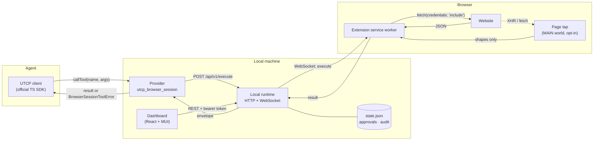
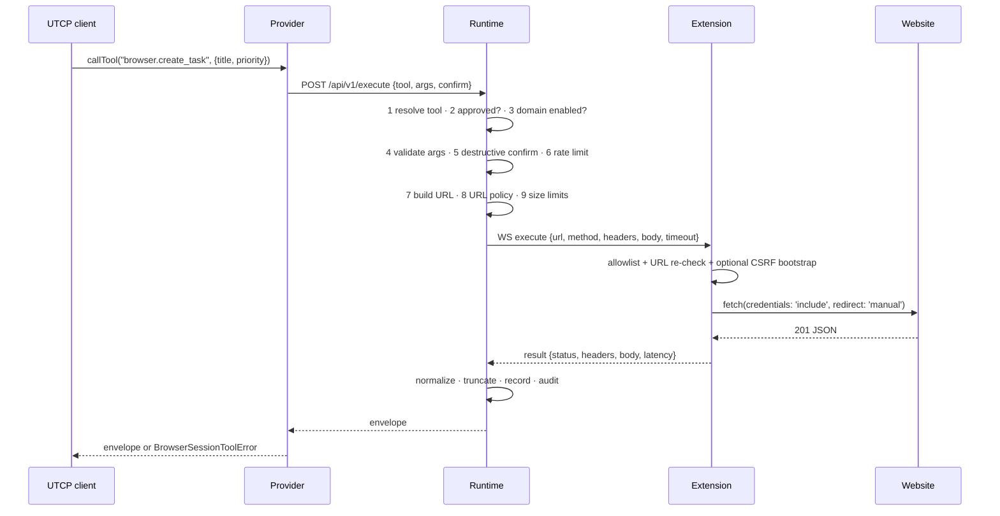
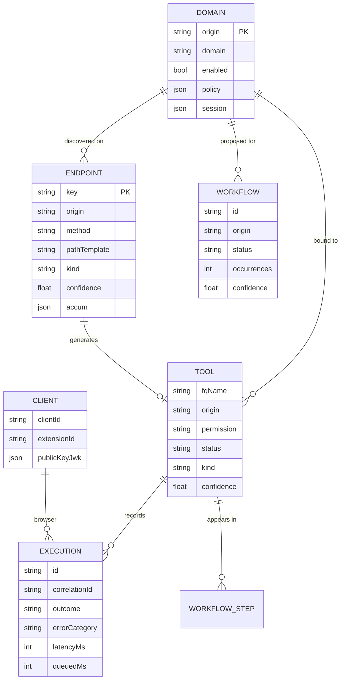

# Architecture

## The shape of it

One browser extension, one local runtime, one UTCP transport plugin. The runtime
is a single process for every website — there is no per-site server, no proxy
per service, and no credential store.

## Components

### `packages/shared` — policy, not plumbing

Pure functions with no I/O, imported by the runtime *and* bundled into the
extension. This is where the security decisions live so both sides make the same
one:

| Module | Responsibility |
| --- | --- |
| `domain.ts` | `normalizeDomain`, `parseDomainInput`, `checkTargetUrl`, `checkRedirect`, SSRF/private-address rejection |
| `permissions.ts` | `classifyPermission` (READ/WRITE/DESTRUCTIVE) and its confidence flag |
| `schema.ts` | shape → JSON Schema, path templating, tool naming, argument validation, request construction |
| `redact.ts` | header/string/object redaction, safe-response-header allowlist |
| `protocol.ts` | zod schemas for every websocket frame and REST payload, plus the stored record types |
| `errors.ts` | the `ErrorCode` catalogue and `ToolError` |

### `packages/runtime` — the only component that holds approvals

- `connections.ts` — the websocket hub. Issues a per-socket nonce, verifies the
  extension's ECDSA signature, correlates `execute` frames with results, enforces
  timeouts, and rejects pending calls when the browser disappears.
- `executor.ts` — the invocation pipeline (see below).
- `store.ts` — one JSON document (`state.json`, mode 0600) with atomic writes.
  Domains, endpoints, tools, executions, audit events, paired clients.
- `http.ts` — REST API, dashboard hosting, the one unauthenticated route
  (`/api/v1/pair/claim`, gated by a one-time code), CORS only for extension
  origins.
- `manual.ts` — builds a `UtcpManual` and validates it with the SDK's own schema.

### `packages/provider` — the UTCP transport

`BrowserSessionCommunicationProtocol extends CommunicationProtocol`:

- `registerManual` fetches `/api/v1/manual` and parses it with `UtcpManualSchema`.
- `callTool` posts to `/api/v1/execute`; a non-`ok` envelope becomes a
  `BrowserSessionToolError` carrying the code and envelope.
- `BrowserSessionCallTemplateSerializer` is registered with
  `CallTemplateSerializer.registerCallTemplate`, which is what makes
  `UtcpManualSchema.parse` accept manuals containing our tools.

Registration happens through `CommunicationProtocol.communicationProtocolFactories`,
so each `UtcpClient` gets its own transport instance (and its own abort
controller for `close()`).

### `extension` — where the credential lives

- `src/background.ts` — pairing, signed handshake, reconnection with backoff and
  an alarm, request execution, discovery plumbing, popup messaging.
- `src/lib/discovery.ts` — merges `webRequest` observations and page-tap shapes.
- `src/tap.ts` — MAIN-world instrumentation of `fetch`/`XMLHttpRequest`. Emits
  **types only** (`{type:'object', properties:{title:{type:'string'}}}`), never
  values, capped at depth 5 and 40 properties per object.
- `src/bridge.ts` — ISOLATED-world relay, because MAIN-world code cannot call
  `chrome.runtime`.

### `dashboard`

React + MUI served by the runtime from `dashboard/dist`. It authenticates with
the runtime bearer token (from `?token=` on first load, then `localStorage`) and
talks only to the runtime's REST API. It never talks to a website.

## The invocation pipeline

Every call walks the same path, in this order. A failure at any step produces a
structured envelope and an audit event; nothing is retried silently.

Steps 1–9 are synchronous and cheap (measured: ~7 µs for validation + request
construction). The only network hop is step 8 → the browser.

## Data model

**The origin is the key.** `scheme://host[:port]` identifies a domain record, its
endpoints, its tools, its policy, its session state and its audit entries. The
hostname is stored alongside and is still the check applied to every outgoing
request. Two applications on `127.0.0.1` with different ports are two domains in
every sense — before the audit they collided, because lookups used the hostname.

**Two storage shapes.** Configuration (domains, tools, clients, workflows) lives
in `state.json` and is written atomically when it changes. The two append-only
streams — executions and audit events — live in rotated NDJSON files, because a
tool call must not pay for rewriting the whole document (see
`docs/audit-report.md` §4 and `docs/performance.md`).

## Design decisions and their trade-offs

| Decision | Why | Cost |
| --- | --- | --- |
| Service-worker `fetch` instead of CDP `Network` | No `debugger` permission, no "Chrome is being debugged" banner, no raw traffic interception | No access to response headers Chrome hides, no streaming bodies |
| Opt-in MAIN-world tap for schemas | MV3 `webRequest` cannot see bodies | Page CSP can block it on strict sites; degrades to method/path only |
| Origin as the identity, hostname as the check | Two apps on one host stay isolated; port-swap tricks are refused | Sites served on several hosts need several entries (by design) |
| All tools start as drafts | Discovery is noisy; a human must recognise intent | One approval step per tool |
| JSON state file + NDJSON event log, not SQLite | No native module, no migrations, easy to inspect and diff; appends keep the hot path at ~0.25 ms per call | Single-writer; rotation bounds the log instead of the database |
| JSON state file, not a database *service* | Zero deployment | Not multi-user |
| ECDSA pairing keys | The runtime never holds a credential that can impersonate the browser | Slightly more code than a shared secret |
| Provider talks HTTP to the runtime | Keeps the transport stateless and testable; any UTCP client can do the same | One extra localhost hop per call |

## Wire protocol

All frames are JSON, validated with zod, and capped at 512 KiB.

**Runtime → extension:** `challenge`, `sync`, `execute`, `discovery_start`,
`discovery_stop`, `ping`.

**Extension → runtime:** `hello`, `result`, `discovery`, `status`, `pong`,
`intent`.

The popup cannot hold the runtime token, so user actions from the popup
(`discovery_start`, `discovery_stop`, `enable_domain`, `disable_domain`) are
forwarded as `intent` frames over the already-authenticated socket.

## What is deliberately absent

- No native messaging host.
- No third-party telemetry.
- No stealth patches, no header spoofing, no `Runtime.enable` tricks.
- No cookie-reading API anywhere in the extension.
- No fallback to a direct HTTP request when the browser is unavailable.
