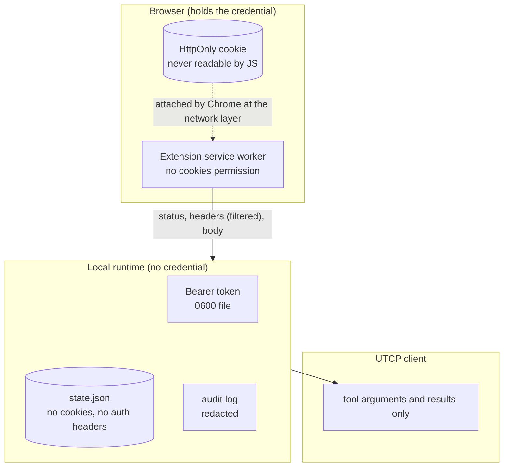

# Security model

This document is the contract. If the code and this document disagree, that is a
bug — please report it.

## Boundary diagram

## Assets

| Asset | Where it lives | Who can read it |
| --- | --- | --- |
| Website session cookie | Browser cookie jar (HttpOnly) | Chrome only. Never extension JS, never the runtime |
| Website CSRF token | Fetched on demand into a local variable | Extension, for the duration of one request |
| Runtime bearer token | `~/.utcp-browser-session/runtime-token` (0600) | The user's account |
| Pairing private key | `chrome.storage.local` in the extension | The extension, that Chrome profile |
| Pairing public key | `state.json` | The user's account |
| Approvals, audit, executions | `state.json` (0600), redacted | The user's account |
| Tool results | Client memory, execution preview (redacted) | The client, the dashboard |

## Threat model

**In scope.** A malicious or buggy *website* that answers a tool call; a
malicious *page* that tries to influence discovery; a *network* attacker on
localhost; a *third-party process* that can make HTTP requests but not read the
user's files; a *UTCP client* (an AI agent) that calls tools with hostile
arguments.

**Out of scope.** An attacker who can read the user's browser profile, the
runtime data directory, or run code as the user. Once that is true, the browser
and the runtime are both compromised. Also out of scope: a site's own
authorisation decisions, and CAPTCHA/bot-detection arms races.

## Controls

### Authentication between components

- **Extension ↔ runtime.** The extension generates an ECDSA P-256 key pair once.
  At pairing it sends the public half; the runtime stores only that. Every
  websocket connection starts with a fresh 24-byte nonce; the extension signs
  `${clientId}:${nonce}`; the runtime verifies with the stored public key and
  rejects a timestamp older than 60 s. The nonce is per-socket and single-use, so
  a captured handshake cannot be replayed.
- **Client ↔ runtime.** A 32-byte bearer token, generated on first start and
  stored with mode 0600. Compared in constant time. Every `/api/*` route
  requires it except `/api/v1/pair/claim`.
- **Pairing code.** 8 characters from a 32-symbol alphabet (no `0/O/1/I`), single
  use, 5-minute TTL, minted only by an authenticated dashboard action. Claims
  must present a valid `chrome-extension://` origin and an `extensionId` that
  matches it.

### Domain and URL policy

Enforced on both sides of the websocket:

1. The tool's domain must be enabled (`enabled: true`) at call time.
2. The URL must parse, be `http(s)`, carry no credentials, contain no control
   characters, backslashes or encoded CR/LF, and be ≤ 2048 bytes.
3. `url.hostname` must equal the tool's domain exactly — no suffix matching, no
   wildcards.
4. When the domain has a recorded `origin`, `url.origin` must equal it exactly
   (scheme + host + **port**), which is what stops a fixture on `:8788` from
   being reachable at `:9999`.
5. `http:` is only allowed for loopback; public hosts must use `https:`.
6. Private address literals (`10/8`, `172.16/12`, `192.168/16`, `169.254/16`,
   `100.64/10`, `127/8` other than loopback) are refused before any request.
7. Redirects are never followed blindly. The extension uses
   `redirect: 'manual'`; an opaque redirect is reported as `redirect_blocked`.
   If a real `3xx` with a `Location` ever arrives, the runtime validates the
   destination against the same domain/origin rules and caps the chain at 2.

Argument values cannot change the host: path parameters are
`encodeURIComponent`-escaped into their segment, and query parameters are built
with `URLSearchParams`. A test asserts that `id: "http://169.254.169.254/…"`
stays inside the path.

### Approvals and permissions

- Every generated tool starts as `draft`. A draft is invisible to the manual and
  refused by the executor.
- `approved` requires an authenticated action and an enabled domain.
- Disabling a domain revokes its tools.
- `revoked` tools are refused and never appear in a manual.
- Classification: `GET/HEAD/OPTIONS → READ`, `DELETE → DESTRUCTIVE`,
  `POST/PUT/PATCH → WRITE` unless the path matches a destructive verb
  (`delete`, `destroy`, `remove`, `purge`, `drop`, `revoke`, `terminate`,
  `wipe`, `reset`, `archive`, `deactivate`, `disable`). An unknown method is
  classified `WRITE` **and** flagged `reviewRequired`.
- `DESTRUCTIVE` requires `__confirm: true` on the call. The flag is stripped
  before the request is built, so it can never reach a website.

### Request and response limits

| Limit | Value | Enforced by |
| --- | --- | --- |
| Request body | 256 KiB | Runtime (before dispatch) |
| Response body | 1 MiB (configurable, max 8 MiB) | Extension + runtime (truncate + flag) |
| Websocket frame | 512 KiB | `ws` `maxPayload` + explicit check |
| REST body | 1 MiB | Runtime |
| Timeout | 30 s default (1–120 s) | Extension `AbortController` + runtime timer |
| Redirects | 2 | Runtime |
| Rate | 60 calls/min/tool (configurable ≤ 600) | Runtime sliding window |

### Credential hygiene

- The extension requests **no** `cookies` permission. There is no code path that
  reads `document.cookie`, `chrome.cookies`, or a request's `Cookie` header.
- The runtime's result envelope includes only an allowlist of response headers:
  `content-type`, `content-length`, `etag`, `x-request-id`, `retry-after`.
  `set-cookie` and `authorization` are dropped, not redacted.
- Everything written to `state.json`, the audit log, execution previews and the
  logger passes through `redactValue`, which masks known secret header names,
  `Bearer`/`Basic` credentials, JWTs, ≥40-character token-shaped strings and
  `name=value` cookie pairs.
- Generated manuals contain `${UTCP_BROWSER_SESSION_TOKEN}`, never a literal.
  `validateManualDocument` refuses a manual that contains credential material or
  a literal token.
- Response bodies are **not** stored in full: the execution record keeps a
  1500-byte redacted preview.

### Local communication

- The runtime binds `127.0.0.1` by default. Binding elsewhere is possible but
  prints no warning — the token is then your only control, so don't.
- Dashboard CORS headers are emitted only for `chrome-extension://` origins, and
  only on the pairing route.
- The websocket upgrade requires a `chrome-extension://` origin that matches the
  paired client's extension id.
- The runtime is **not** a proxy: there is no route that forwards an arbitrary
  URL. The only path to a website is an approved tool on an enabled domain.

## Audited events

`tool.executed`, `tool.rejected`, `tool.failed`, `tool.approved`, `tool.revoked`,
`tools.generated`, `domain.enabled`, `domain.disabled`, `discovery.started`,
`discovery.stopped`, `pair.code_created`, `pair.claimed`, `pair.claim_rejected`,
`extension.connected`, `extension.disconnected`, `extension.handshake_rejected`,
`request.redirect_blocked`.

Each event stores: timestamp, kind, severity, actor, domain, tool name, a short
message and a redacted detail object. A security test scans the whole audit log
for the injected secrets.

## Residual risks

1. **A compromised local account is game over.** Anyone who can read the browser
   profile can use the session directly; anyone who can read
   `~/.utcp-browser-session` can drive a paired browser.
2. **A fake runtime on the same port** could ask the extension to sign arbitrary
   nonces (not the private key) and then request executions for enabled domains.
   This requires the attacker to already run code as the user. The extension
   refuses non-loopback runtime URLs, which limits the blast radius.
3. **Schema inference is structural.** A site could return a field it never
   returns again; the merged schema widens and a required field may be
   over-reports. Tools are drafts until a human checks the shape.
4. **`Origin` is attacker-controlled by the page, not by the extension.** An
   extension-originated POST carries `Origin: chrome-extension://…`; a site that
   requires a same-origin `Origin` cannot be called at all (see limitations).
5. **CSRF tokens are fetched on demand.** If a site rotates tokens per request or
   binds them to a nonce the extension cannot see, writes will fail with the
   site's own error. Nothing is bypassed.
6. **Zod advisory.** See `SECURITY.md`; mitigated by hard size caps.
